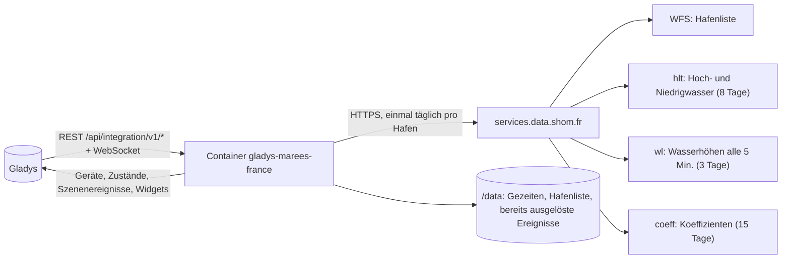
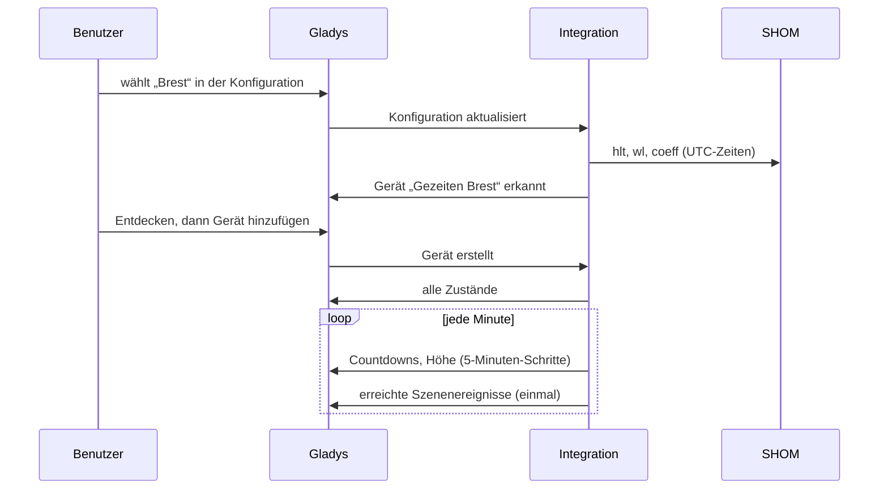
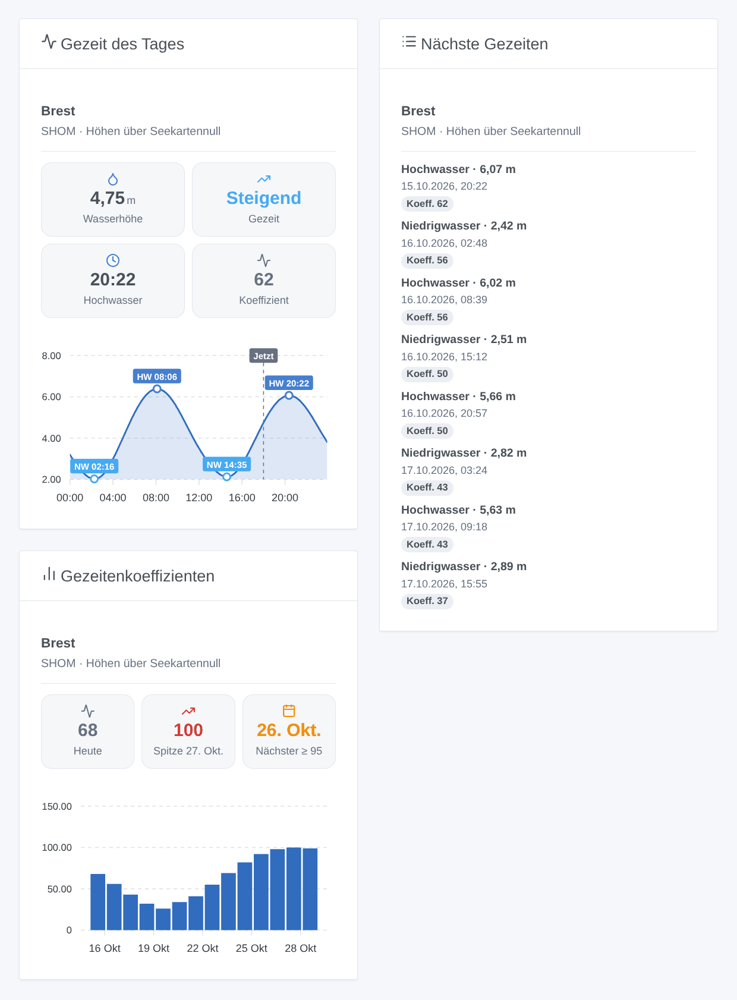

# Gladys Marées France

[English](README.md) · [Français](README.fr.md) · **Deutsch** · [Español](README.es.md)

[](LICENSE)
[](https://github.com/William-De71/gladys-marees-france/releases)
[](https://github.com/William-De71/gladys-marees-france/actions/workflows/release.yml)
[](https://gladysassistant.com)


Externe Integration für [Gladys Assistant](https://gladysassistant.com) zu den **Gezeiten französischer Häfen**: Zeiten und Höhen von Hoch- und Niedrigwasser, Koeffizienten und die aktuelle Wasserhöhe, nach den Vorhersagen des [SHOM](https://maree.shom.fr/) (Frankreich, Überseegebiete und einige ausländische Häfen). Szenen lösen vor jeder Gezeit oder bei Springtiden aus, und drei Widgets zeigen die Kurve des Tages, die nächsten Gezeiten und die Koeffizienten.

Benutzerdokumentation: [English](docs/en.md) · [Français](docs/fr.md) · [Deutsch](docs/de.md) · [Español](docs/es.md).

> Community-Integration, weder mit dem SHOM verbunden noch von ihm unterstützt. Die Vorhersagen bleiben Eigentum des SHOM; sie ersetzen keine amtlichen nautischen Unterlagen.

## Funktionen

- Bis zu **5 Häfen** aus den 387 der SHOM-Liste: Auswahl in einer Liste oder per Name (Suche ohne Akzente und Groß-/Kleinschreibung), nie JSON.
- Ein **Gerät pro Hafen**: aktuelle Wasserhöhe, steigende oder fallende Gezeit, nächste Gezeit im Klartext, Minuten bis zum nächsten Hoch- und Niedrigwasser und deren Höhen, Koeffizient des nächsten Hochwassers und höchster Koeffizient von morgen.
- **2 Szenenauslöser** (Hoch- oder Niedrigwasser in N Minuten oder jetzt; Springtide mit Koeffizient ≥ N), **1 Szenenaktion** (nächste Gezeit lesen) und **3 Widgets** (siehe unten).
- Download **einmal täglich** (drei Anfragen pro Hafen), Daten in `/data`; alles andere wird jede Minute lokal berechnet.
- Vier Sprachen überall: Englisch, Französisch, Deutsch, Spanisch.

## Funktionsweise




Von der Konfiguration zum Zustand:



Die Adressen der Dienste und ihre Fallstricke stammen aus der Home-Assistant-Integration [KipK/marees_france](https://github.com/KipK/marees_france) (MIT), am echten Dienst geprüft. Die Zeiten werden in UTC abgefragt und in die Zeitzone von Gladys umgerechnet (die der Supervisor an den Container übergibt).

### Transport

`transports: ["cloud"]`: Die Integration liest die öffentlichen Dienste des SHOM über das Internet. Sie sendet nichts über Sie: Nur der Hafencode steht in den Anfragen. Sie gibt sich wie die Website maree.shom.fr aus (`Referer`-Header und Browser), sonst lehnt der Dienst ab; seine Firewall sperrt hartnäckige Adressen eine Weile, daher ein einziger Download pro Tag, verteilte Anfragen und 3 Stunden Pause nach einer Ablehnung.

## Geräte und Funktionen

| Funktion                                 | Kategorie / Typ              | Einheit |
| ---------------------------------------- | ---------------------------- | ------- |
| Wasserhöhe                               | `level-sensor` / `decimal`   | m       |
| Gezeit (steigend / fallend)              | `text` / `text`              | —       |
| Nächste Gezeit (Klartext)                | `text` / `text`              | —       |
| Hochwasser in / Niedrigwasser in         | `duration` / `integer`       | Minuten |
| Höhe des nächsten Hoch- / Niedrigwassers | `level-sensor` / `decimal`   | m       |
| Koeffizient, höchster Koeffizient morgen | `counter-sensor` / `integer` | —       |

Ein Gerät „Gezeiten &lt;Hafen&gt;“ pro Hafen, externe ID auf Basis des SHOM-Codes (`BREST`, `FORT-DE-FRANCE`). Koeffizienten gibt es nur für Häfen, die welche haben. Höhen über Seekartennull, wie auf maree.shom.fr.

## Szenenauslöser, Aktionen und Widgets



**Widgets**: Gezeit des Tages (Wasserhöhe, Tendenz, nächste Gezeit, Koeffizient, Tageskurve mit Hoch- und Niedrigwasser), Nächste Gezeiten (die nächsten acht, datiert, mit Koeffizient), Gezeitenkoeffizienten (zwei Wochen als Balken, Spitze und nächste Springtide). Gemeinsame Einstellung: der Hafen (leer = der erste der Konfiguration).

**Auslöser**:

- **Gezeiten: Hoch- oder Niedrigwasser** — zur Zeit der Gezeit oder 15 Min. bis 6 Std. vorher; Filter Hafen und Gezeitentyp.
- **Gezeiten: Springtide** — ein Hochwasser mit Koeffizient ≥ 70 bis 115, zu seiner Zeit oder bis zum Vortag; das folgende Niedrigwasser wird mitgeliefert (Wattfischen).

**Aktion**: die nächste Gezeit (Hoch-, Niedrigwasser oder die nächste) eines Hafens lesen, mit einer Zusammenfassung für eine Nachricht.

Beispiele:

- 1 Std. vor Hochwasser in Saint-Malo → „Hochwasser um 10:40 (10,49 m, Koeff. 56)“ per Telegram senden.
- Am Vortag einer Springtide mit Koeffizient ≥ 95 → die Familie mit der Zeit des Niedrigwassers benachrichtigen.
- Bei Niedrigwasser → den Rollladen des Bootsstegs schließen (oder ein anderes Gerät schalten).

## Voraussetzungen

- Gladys Assistant **5.1.0** oder neuer (Widgets und Szenen): ältere Instanzen können die Integration nicht installieren.
- Internetzugang von Gladys. Kein Konto, kein Schlüssel.

## Installation

- **Aus dem Store**: Integrationen → Marées France → Installieren.
- **Über die Repository-URL**: Integrationen → externe Integration → `https://github.com/William-De71/gladys-marees-france`.
- **Entwicklermodus**: `npm start` mit den von Gladys bereitgestellten Variablen (siehe Entwicklung).

## Konfiguration

| Feld              | Standard    | Rolle                                                                          |
| ----------------- | ----------- | ------------------------------------------------------------------------------ |
| Hafen             | —           | Der Haupthafen aus der SHOM-Liste (Anfangsbuchstaben tippen, um hinzuspringen) |
| Weitere Häfen     | —           | Bis zu vier weitere, nach Namen, durch Kommas getrennt (`Saint-Malo, Roscoff`) |
| Sprache der Texte | automatisch | Gerätenamen, Textzustände und Szenen-Zusammenfassungen                         |

Schaltflächen: **Hafen suchen** (prüft einen Namen), **Jetzt herunterladen**, **Diagnose** (schreibt den Zustand der Integration in den Reiter Protokolle, für einen Fehlerbericht: Gladys übergibt `DEBUG` nicht an den Container).

## Verwendung

1. Einen Hafen wählen, eventuell weitere per Name.
2. **Entdecken**, dann die Geräte „Gezeiten …“ hinzufügen.
3. Die Widgets einem Dashboard hinzufügen und Szenen mit den Auslösern und der Aktion erstellen.

## Entwicklung

```bash
npm install
npm test                       # node --test, nie mit Netzwerkzugriff
npm run lint                   # ESLint
npm run format:check           # Prettier
npx github:GladysAssistant/integration-store . --skip-image-check
node scripts/update-ports.mjs  # Hafenliste (src/ports.json und das Select des Manifests)
scripts/build-cover.sh         # cover.jpg aus docs/assets/cover.svg
docs/illustrations/render.sh   # docs/assets/widgets.<Sprache>.png
```

Lokal liest das SDK `GLADYS_HOST_API_URL`, `GLADYS_INTEGRATION_TOKEN` und `GLADYS_INTEGRATION_SELECTOR` (von Gladys im Entwicklermodus bereitgestellt); `TZ` legt die Zeitzone fest. `DEBUG=gladys-integration-sdk` zeigt die SDK-Protokolle.

Die Tests nutzen echte Antworten des SHOM (Brest, Fort-de-France): Client und Fehlerarten (Firewall, unbekannter Hafen), Lesen von Gezeiten und Höhen, lokale Tage und Zeitumstellung, Geräte (die Felder, die der Erkennungsbildschirm verlangt), Szenenereignisse (nur einmal, 10 Minuten Kulanz), Widgets (`validateWidgetContent`), Manifest, vier Sprachen, Release-Skript und die ganze Integration gegen das Fake-Gladys des SDK. `test/structure.test.js` friert alle bei Benutzern gespeicherten Schlüssel ein, Hafencodes inklusive.

## Release-Prozess


Jeder Merge auf `main` startet die CI und berechnet dann die Version aus den [Conventional Commits](https://www.conventionalcommits.org/) seit dem letzten Tag: `feat` → Minor, `fix` / `perf` → Patch, `!` oder `BREAKING CHANGE` → Major (Minor unter 1.0.0); `docs`, `chore`, `ci`, `test`, `style`, `refactor`, `build` allein veröffentlichen nichts. Der Changelog-Abschnitt wird erzeugt, der Tag gepusht, das Multi-Architektur-Image gebaut, dann erhält `main` den Release-Commit, das GitHub-Release wird erstellt und ein letzter Job prüft das öffentliche Image, den Store-Validator und das Topic.

- Der Titel des Pull Requests wird zum Squash-Commit und dann zur Changelog-Zeile: auf Englisch und für den Benutzer schreiben (`pr-title.yml` prüft es). `CHANGELOG.md` nie von Hand bearbeiten.
- 1.0.0 ist eine Entscheidung: Actions → Release → Run workflow mit `release-as: 1.0.0`. `dry-run` zeigt Version und Notizen, ohne etwas zu veröffentlichen.
- **Geschützter Branch**: Das Release pusht seinen Commit mit `GITHUB_TOKEN` auf `main`. Bei einer Regel auf `main` GitHub Actions zur Bypass-Liste hinzufügen (oder über eine GitHub App pushen), sonst schlägt der Veröffentlichungsjob mit Anweisungen fehl.
- Nach dem ersten Release das Paket `ghcr.io` öffentlich machen (Package settings → Change visibility), sonst kann Gladys es nicht herunterladen.

## Fehlerbehebung

Siehe [docs/de.md](docs/de.md#fehlerbehebung). Probleme mit den Versionen von Gladys und der Integration, dem betroffenen Hafen und der Ausgabe der Schaltfläche **Diagnose** (Reiter Protokolle) melden.

## Mitwirken

Issues und Pull Requests willkommen. Vor einem Pull Request `npm run format:check && npm run lint && npm test` ausführen und alle externen IDs und gespeicherten Schlüssel unverändert lassen (siehe [CLAUDE.md](CLAUDE.md)).

## Sicherheit

Siehe [SECURITY.md](SECURITY.md): Schwachstellen vertraulich melden. Die Integration hat weder Geheimnis noch Konto; sie schreibt nur in `/data`.

## Kommende Screenshots

Die Bilder oben sind Illustrationen, keine Screenshots. Echte Screenshots kommen nach `docs/assets/screenshots/` (PNG, 1280 × 800): `configuration.png`, `discovery.png`, `device.png`, `scene.png`.

## Lizenz

[Apache-Lizenz 2.0](LICENSE) — siehe auch [NOTICE](NOTICE). Gezeitenvorhersagen: © SHOM, gelesen wie auf maree.shom.fr für den persönlichen Gebrauch; dieses Repository verbreitet sie nicht weiter (außer einigen für die Tests aufgezeichneten Antworten). Dank an die Dokumentation und das SDK von Gladys sowie an die Home-Assistant-Integration marees_france.
