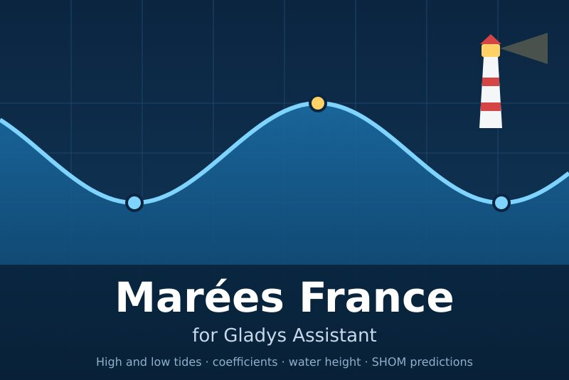
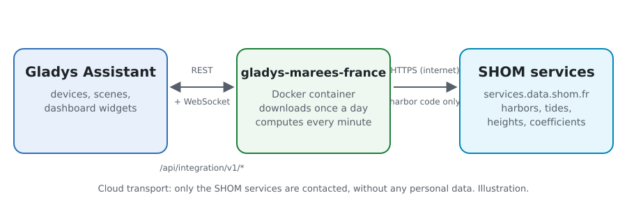
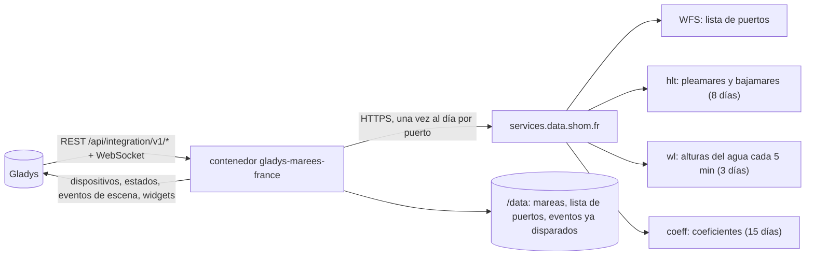
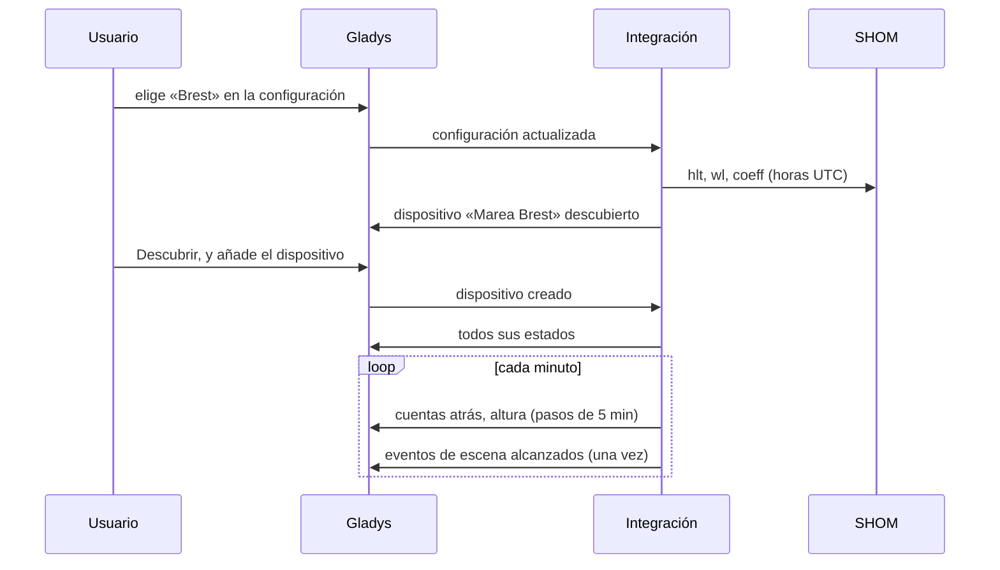
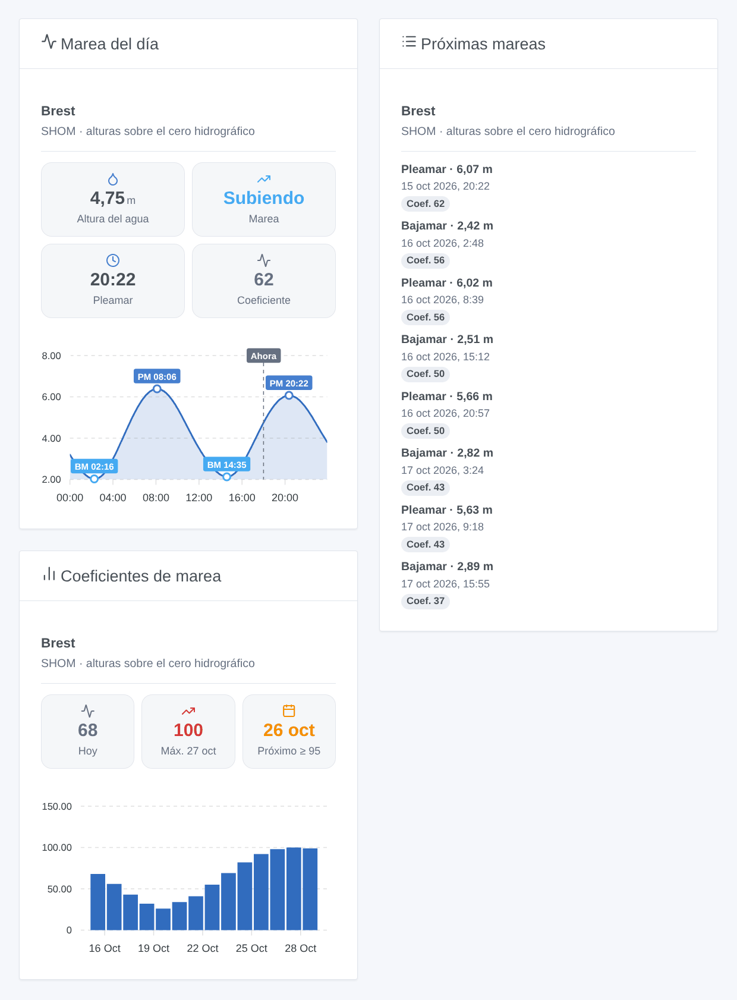
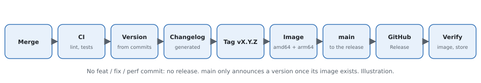

# Gladys Marées France

[English](README.md) · [Français](README.fr.md) · [Deutsch](README.de.md) · **Español**

[](LICENSE)
[](https://github.com/William-De71/gladys-marees-france/releases)
[](https://github.com/William-De71/gladys-marees-france/actions/workflows/release.yml)
[](https://gladysassistant.com)



Integración externa de [Gladys Assistant](https://gladysassistant.com) para las **mareas de los puertos franceses**: horas y alturas de pleamares y bajamares, coeficientes y la altura del agua en todo momento, según las predicciones del [SHOM](https://maree.shom.fr/) (Francia metropolitana, ultramar y algunos puertos extranjeros). Las escenas se activan antes de cada marea o en las mareas vivas, y tres widgets muestran la curva del día, las próximas mareas y los coeficientes.

Documentación de usuario: [English](docs/en.md) · [Français](docs/fr.md) · [Deutsch](docs/de.md) · [Español](docs/es.md).

> Integración comunitaria, sin afiliación con el SHOM ni respaldo suyo. Las predicciones siguen siendo propiedad del SHOM; no sustituyen los documentos náuticos oficiales.

## Funciones

- Hasta **5 puertos** entre los 387 de la lista del SHOM: elegidos en una lista desplegable o por su nombre (búsqueda sin acentos ni mayúsculas), nunca JSON.
- Un **dispositivo por puerto**: altura del agua actual, marea subiendo o bajando, próxima marea en texto, minutos hasta la próxima pleamar y bajamar y sus alturas, coeficiente de la próxima pleamar y coeficiente máximo de mañana.
- **2 disparadores de escena** (pleamar o bajamar en N minutos o ahora; marea viva de coeficiente ≥ N), **1 acción de escena** (leer la próxima marea) y **3 widgets** (abajo).
- Descarga **una vez al día** (tres solicitudes por puerto), datos guardados en `/data`; todo lo demás se calcula localmente cada minuto.
- Cuatro idiomas en todas partes: inglés, francés, alemán, español.

## Funcionamiento





De la configuración a un estado:



Las direcciones de los servicios y sus trampas vienen de la integración de Home Assistant [KipK/marees_france](https://github.com/KipK/marees_france) (MIT), comprobadas en el servicio real. Las horas se piden en UTC y se convierten a la zona horaria de Gladys (que el supervisor pasa al contenedor).

### Transporte

`transports: ["cloud"]`: la integración lee los servicios públicos del SHOM por Internet. No envía nada sobre usted: solo el código del puerto aparece en las solicitudes. Se presenta como el sitio maree.shom.fr (cabecera `Referer` y navegador), si no el servicio rechaza; su cortafuegos bloquea un tiempo las direcciones insistentes, de ahí una sola descarga al día, solicitudes espaciadas y una pausa de 3 horas tras un rechazo.

## Dispositivos y funciones

| Función                                | Categoría / tipo             | Unidad  |
| -------------------------------------- | ---------------------------- | ------- |
| Altura del agua                        | `level-sensor` / `decimal`   | m       |
| Marea (subiendo / bajando)             | `text` / `text`              | —       |
| Próxima marea (en texto)               | `text` / `text`              | —       |
| Pleamar en / Bajamar en                | `duration` / `integer`       | minutos |
| Altura de la próxima pleamar / bajamar | `level-sensor` / `decimal`   | m       |
| Coeficiente, coeficiente máximo mañana | `counter-sensor` / `integer` | —       |

Un dispositivo «Marea &lt;puerto&gt;» por puerto, con un identificador externo basado en el código SHOM del puerto (`BREST`, `FORT-DE-FRANCE`). Los coeficientes solo existen para los puertos que los tienen. Las alturas son sobre el cero hidrográfico, como en maree.shom.fr.

## Disparadores, acciones de escena y widgets



**Widgets**: Marea del día (altura del agua, tendencia, próxima marea, coeficiente, curva del día con sus pleamares y bajamares), Próximas mareas (las ocho siguientes, fechadas, con su coeficiente), Coeficientes de marea (dos semanas en barras, pico y próxima marea viva). Ajuste común: el puerto (vacío = el primero de la configuración).

**Disparadores**:

- **Marea: pleamar o bajamar** — a la hora de la marea o de 15 min a 6 h antes; filtros puerto y tipo de marea.
- **Marea: marea viva** — una pleamar de coeficiente ≥ 70 a 115, a su hora o hasta el día antes; se da la bajamar siguiente (marisqueo).

**Acción**: leer la próxima marea (pleamar, bajamar o la próxima) de un puerto, con un resumen listo para un mensaje.

Ejemplos:

- 1 h antes de la pleamar en Saint-Malo → enviar «Pleamar a las 10:40 (10,49 m, coef. 56)» por Telegram.
- El día antes de una marea viva de coeficiente ≥ 95 → avisar a la familia con la hora de la bajamar, para el marisqueo.
- En la bajamar → cerrar la persiana del pontón (u otro dispositivo).

## Requisitos

- Gladys Assistant **5.1.0** o más reciente (widgets y escenas): las instancias más antiguas no pueden instalar la integración.
- Acceso a Internet desde Gladys. Sin cuenta, sin clave.

## Instalación

- **Desde la tienda**: Integraciones → Marées France → Instalar.
- **Desde la URL del repositorio**: Integraciones → integración externa → `https://github.com/William-De71/gladys-marees-france`.
- **Modo desarrollador**: ejecute `npm start` con las variables que da Gladys (ver Desarrollo).

## Configuración

| Campo                | Por defecto | Función                                                                   |
| -------------------- | ----------- | ------------------------------------------------------------------------- |
| Puerto               | —           | El puerto principal, en la lista del SHOM (escriba sus primeras letras)   |
| Otros puertos        | —           | Hasta cuatro más, por nombre, separados por comas (`Saint-Malo, Roscoff`) |
| Idioma de los textos | automático  | Nombres de dispositivos, estados de texto y resúmenes de escenas          |

Botones: **Buscar un puerto** (comprueba un nombre), **Descargar ahora**, **Diagnóstico** (escribe el estado de la integración en la pestaña Registros, para adjuntar a un informe de error: Gladys no pasa `DEBUG` al contenedor).

## Uso

1. Elija un puerto, y quizá otros por su nombre.
2. **Descubra** y añada los dispositivos «Marea …».
3. Añada los widgets a un panel y cree escenas con los disparadores y la acción.

## Desarrollo

```bash
npm install
npm test                       # node --test, nunca toca la red
npm run lint                   # ESLint
npm run format:check           # Prettier
npx github:GladysAssistant/integration-store . --skip-image-check
node scripts/update-ports.mjs  # lista de puertos (src/ports.json y el select del manifiesto)
scripts/build-cover.sh         # cover.jpg desde docs/assets/cover.svg
docs/illustrations/render.sh   # docs/assets/widgets.<idioma>.png
```

En local, el SDK lee `GLADYS_HOST_API_URL`, `GLADYS_INTEGRATION_TOKEN` y `GLADYS_INTEGRATION_SELECTOR` (proporcionadas por Gladys en modo desarrollador); `TZ` fija la zona horaria. `DEBUG=gladys-integration-sdk` muestra los registros del SDK.

Las pruebas usan respuestas reales del SHOM (Brest, Fort-de-France): cliente y tipos de error (cortafuegos, puerto desconocido), lectura de mareas y alturas, días locales y cambio de hora, dispositivos (los campos que exige la pantalla de descubrimiento), eventos de escena (una sola vez, margen de 10 min), widgets (`validateWidgetContent`), manifiesto, cuatro idiomas, script de release y la integración completa frente al Gladys falso del SDK. `test/structure.test.js` congela todas las claves guardadas por los usuarios, códigos de puerto incluidos.

## Proceso de release



Cada fusión en `main` lanza la CI y calcula la versión según los [Conventional Commits](https://www.conventionalcommits.org/) desde la última etiqueta: `feat` → menor, `fix` / `perf` → parche, `!` o `BREAKING CHANGE` → mayor (una menor mientras sea inferior a 1.0.0); `docs`, `chore`, `ci`, `test`, `style`, `refactor`, `build` solos no publican nada. Se genera la sección del changelog, se empuja la etiqueta, se construye la imagen multiarquitectura, luego `main` recibe el commit de release, se crea la GitHub Release y un último job comprueba la imagen pública, el validador de la tienda y el topic.

- El título de la pull request se convierte en el commit squash y luego en la línea del changelog: escríbalo en inglés, para el usuario (`pr-title.yml` lo comprueba). Nunca edite `CHANGELOG.md` a mano.
- 1.0.0 es una decisión: Actions → Release → Run workflow con `release-as: 1.0.0`. `dry-run` muestra la versión y las notas sin publicar nada.
- **Rama protegida**: la release empuja su commit a `main` con `GITHUB_TOKEN`. Con una regla en `main`, añada GitHub Actions a su lista de omisión (o empuje mediante una GitHub App); si no, el job de publicación falla con instrucciones.
- Tras la primera release, haga público el paquete `ghcr.io` (Package settings → Change visibility); si no, Gladys no puede descargarlo.

## Solución de problemas

Ver [docs/es.md](docs/es.md#solución-de-problemas). Informe de los problemas con las versiones de Gladys y de la integración, el puerto afectado y la salida del botón **Diagnóstico** (pestaña Registros).

## Contribuir

Issues y pull requests bienvenidos. Ejecute `npm run format:check && npm run lint && npm test` antes de abrir una pull request, y mantenga sin cambios todos los identificadores externos y claves guardadas (ver [CLAUDE.md](CLAUDE.md)).

## Seguridad

Ver [SECURITY.md](SECURITY.md): informe de vulnerabilidades en privado. La integración no tiene secreto ni cuenta; solo escribe en `/data`.

## Capturas por venir

Las imágenes de arriba son ilustraciones, no capturas de pantalla. Las capturas reales irán a `docs/assets/screenshots/` (PNG, 1280 × 800): `configuration.png`, `discovery.png`, `device.png`, `scene.png`.

## Licencia

[Licencia Apache 2.0](LICENSE) — ver también [NOTICE](NOTICE). Predicciones de marea: © SHOM, leídas como en maree.shom.fr para uso personal; este repositorio no las redistribuye (salvo algunas respuestas grabadas para las pruebas). Gracias a la documentación y al SDK de Gladys, y a la integración de Home Assistant marees_france.
