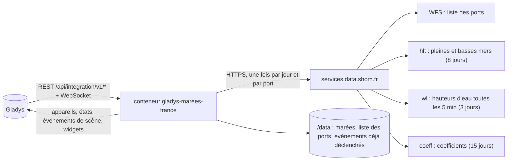
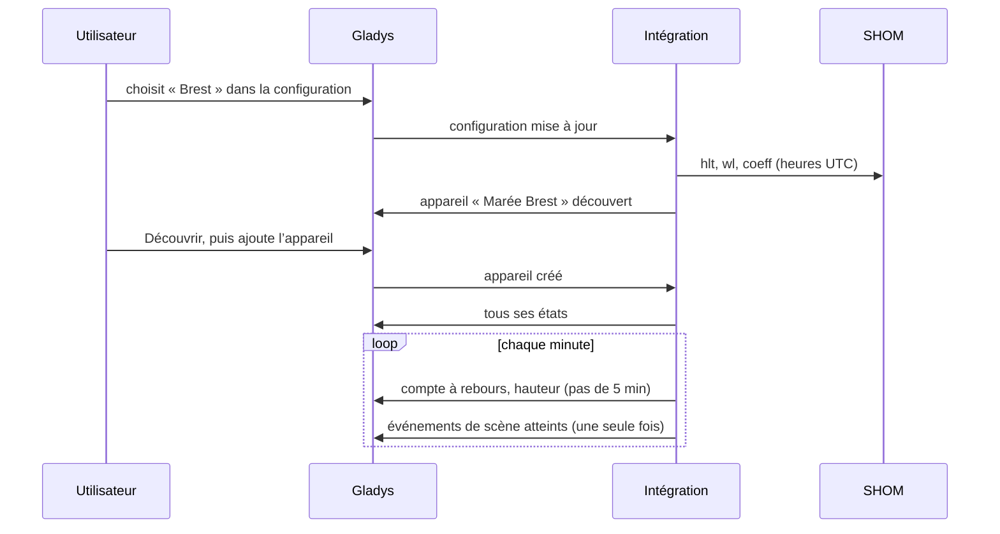
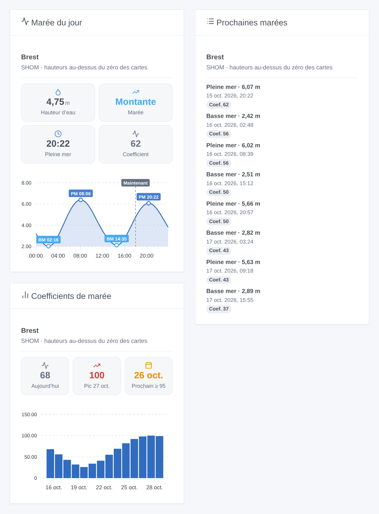

# Gladys Marées France

[English](README.md) · **Français** · [Deutsch](README.de.md) · [Español](README.es.md)

[](LICENSE)
[](https://github.com/William-De71/gladys-marees-france/releases)
[](https://github.com/William-De71/gladys-marees-france/actions/workflows/release.yml)
[](https://gladysassistant.com)


Intégration externe [Gladys Assistant](https://gladysassistant.com) pour les **marées des ports français** : heures et hauteurs des pleines et basses mers, coefficients et hauteur d’eau en continu, d’après les prédictions du [SHOM](https://maree.shom.fr/) (métropole, outre-mer et quelques ports étrangers). Des scènes se déclenchent avant chaque marée ou lors des grandes marées, et trois widgets montrent la courbe du jour, les prochaines marées et les coefficients.

Documentation utilisateur : [English](docs/en.md) · [Français](docs/fr.md) · [Deutsch](docs/de.md) · [Español](docs/es.md).

> Intégration communautaire, ni affiliée au SHOM ni approuvée par lui. Les prédictions restent la propriété du SHOM ; elles ne remplacent pas les documents nautiques officiels.

## Fonctionnalités

- Jusqu’à **5 ports** parmi les 387 de la liste du SHOM : choix dans une liste déroulante, ou par leur nom (recherche sans accents ni majuscules), jamais de JSON.
- Un **appareil par port** : hauteur d’eau actuelle, marée montante ou descendante, prochaine marée en clair, minutes avant la prochaine pleine et basse mer et leurs hauteurs, coefficient de la prochaine pleine mer et coefficient maximal du lendemain.
- **2 déclencheurs de scène** (pleine ou basse mer dans N minutes ou à l’heure ; grande marée de coefficient ≥ N), **1 action de scène** (lire la prochaine marée) et **3 widgets** (ci-dessous).
- Téléchargement **une fois par jour** (trois requêtes par port), données gardées dans `/data` ; tout le reste est calculé localement chaque minute.
- Quatre langues partout : anglais, français, allemand, espagnol.

## Fonctionnement




De la recherche à un état :



Les adresses des services et leurs pièges viennent de l’intégration Home Assistant [KipK/marees_france](https://github.com/KipK/marees_france) (MIT), vérifiés sur le service réel. Les heures sont demandées en UTC puis converties dans le fuseau de Gladys (que le superviseur transmet au conteneur).

### Transport

`transports: ["cloud"]` : l’intégration lit les services publics du SHOM sur Internet. Elle n’envoie rien sur vous : seul le code du port figure dans les requêtes. Elle se présente comme le site maree.shom.fr (en-tête `Referer` et navigateur), sans quoi le service refuse ; son pare-feu bloque un moment les adresses trop insistantes, d’où un seul téléchargement par jour, des requêtes espacées et une pause de 3 heures après un refus.

## Appareils et fonctionnalités

| Fonctionnalité                         | Catégorie / type             | Unité   |
| -------------------------------------- | ---------------------------- | ------- |
| Hauteur d’eau                          | `level-sensor` / `decimal`   | m       |
| Marée (montante / descendante)         | `text` / `text`              | —       |
| Prochaine marée (en clair)             | `text` / `text`              | —       |
| Pleine mer dans / Basse mer dans       | `duration` / `integer`       | minutes |
| Hauteur de la prochaine pleine / basse | `level-sensor` / `decimal`   | m       |
| Coefficient, coefficient max demain    | `counter-sensor` / `integer` | —       |

Un appareil « Marée &lt;port&gt; » par port, identifiant externe construit sur le code SHOM du port (`BREST`, `FORT-DE-FRANCE`). Les coefficients n’existent que pour les ports qui en ont. Les hauteurs sont au-dessus du zéro des cartes (zéro hydrographique), comme sur maree.shom.fr.

## Déclencheurs, actions de scène et widgets



**Widgets** : Marée du jour (hauteur d’eau, tendance, prochaine marée, coefficient, courbe de la journée avec ses pleines et basses mers), Prochaines marées (les huit suivantes, datées, avec leur coefficient), Coefficients de marée (deux semaines en barres, pic et prochaine grande marée). Réglage commun : le port (vide = le premier de la configuration).

**Déclencheurs** :

- **Marée : pleine ou basse mer** — à l’heure de la marée ou 15 min à 6 h avant ; filtres port et type de marée.
- **Marée : grande marée** — une pleine mer de coefficient ≥ 70 à 115, à son heure ou jusqu’à la veille ; la basse mer qui suit est fournie (pêche à pied).

**Action** : lire la prochaine marée (pleine, basse ou la prochaine) d’un port, avec un résumé prêt pour un message.

Exemples :

- 1 h avant la pleine mer à Saint-Malo → envoyer « Pleine mer à 10:40 (10,49 m, coef. 56) » sur Telegram.
- La veille d’une grande marée de coefficient ≥ 95 → prévenir la famille avec l’heure de la basse mer, pour la pêche à pied.
- À la basse mer → fermer le volet roulant du ponton (ou tout autre appareil).

## Prérequis

- Gladys Assistant **5.3.0** ou plus récent (mots-clés et pays du catalogue de Gladys 5.3, widgets et scènes) : les instances plus anciennes ne peuvent pas installer l’intégration.
- Un accès à Internet depuis Gladys. Aucun compte, aucune clé.

## Installation

- **Depuis le store** : Intégrations → Marées France → Installer.
- **Depuis l’URL du dépôt** : Intégrations → intégration externe → `https://github.com/William-De71/gladys-marees-france`.
- **Mode développeur** : lancez `npm start` avec les variables fournies par Gladys (voir Développement).

## Configuration

| Champ             | Par défaut  | Rôle                                                                                   |
| ----------------- | ----------- | -------------------------------------------------------------------------------------- |
| Port              | —           | Le port principal, dans la liste du SHOM (tapez ses premières lettres pour y aller)    |
| Autres ports      | —           | Jusqu’à quatre de plus, par leur nom, séparés par des virgules (`Saint-Malo, Roscoff`) |
| Langue des textes | automatique | Noms des appareils, états texte et résumés des scènes                                  |

Boutons : **Rechercher un port** (vérifie un nom), **Télécharger maintenant**, **Diagnostic** (écrit l’état de l’intégration dans l’onglet Journaux, à joindre à un rapport de bug : Gladys ne transmet pas `DEBUG` au conteneur).

## Utilisation

1. Choisissez un port, et éventuellement d’autres par leur nom.
2. **Découvrez**, puis ajoutez les appareils « Marée … ».
3. Ajoutez les widgets à un tableau de bord, et créez des scènes avec les déclencheurs et l’action.

## Développement

```bash
npm install
npm test                       # node --test, ne touche jamais le réseau
npm run lint                   # ESLint
npm run format:check           # Prettier
npx github:GladysAssistant/integration-store . --skip-image-check
node scripts/update-ports.mjs  # liste des ports (src/ports.json et le select du manifeste)
scripts/build-cover.sh         # cover.jpg depuis docs/assets/cover.svg
docs/illustrations/render.sh   # docs/assets/widgets.<langue>.png
```

En local, le SDK lit `GLADYS_HOST_API_URL`, `GLADYS_INTEGRATION_TOKEN` et `GLADYS_INTEGRATION_SELECTOR` (fournis par Gladys en mode développeur) ; `TZ` fixe le fuseau. `DEBUG=gladys-integration-sdk` affiche les journaux du SDK.

Les tests reposent sur de vraies réponses du SHOM (Brest, Fort-de-France) : client et classement des erreurs (pare-feu, port inconnu), lecture des marées et des hauteurs, jours locaux et changement d’heure, appareils (les champs exigés par l’écran de découverte), événements de scène (une seule fois, délai de grâce de 10 min), widgets (`validateWidgetContent`), manifeste, quatre langues, script de release, et l’intégration complète face au faux Gladys du SDK. `test/structure.test.js` fige toutes les clés stockées chez les utilisateurs, codes de port compris.

## Processus de release


Chaque fusion sur `main` lance la CI, puis calcule la version d’après les [Conventional Commits](https://www.conventionalcommits.org/fr/) depuis le dernier tag : `feat` → mineure, `fix` / `perf` → correctif, `!` ou `BREAKING CHANGE` → majeure (une mineure tant qu’on est sous 1.0.0) ; `docs`, `chore`, `ci`, `test`, `style`, `refactor`, `build` seuls ne publient rien. La section du changelog est générée, le tag poussé, l’image multi-architecture construite, puis `main` reçoit le commit de release, la GitHub Release est créée et un dernier job vérifie l’image publique, le validateur du store et le topic.

- Le titre de la pull request devient le commit squash, puis la ligne du changelog : écrivez-le en anglais, pour l’utilisateur (`pr-title.yml` le vérifie). N’éditez jamais `CHANGELOG.md` à la main.
- 1.0.0 est une décision : Actions → Release → Run workflow avec `release-as: 1.0.0`. `dry-run` affiche la version et les notes sans rien publier.
- **Branche protégée** : la release pousse son commit sur `main` avec `GITHUB_TOKEN`. Avec une règle sur `main`, ajoutez GitHub Actions à sa liste de contournement (ou poussez via une GitHub App), sinon le job de publication échoue avec des instructions.
- Après la première release, rendez public le package `ghcr.io` (Package settings → Change visibility), sinon Gladys ne peut pas le télécharger.

## Dépannage

Voir [docs/fr.md](docs/fr.md#dépannage). Signalez les problèmes avec les versions de Gladys et de l’intégration, le port concerné et la sortie du bouton **Diagnostic** (onglet Journaux).

## Contribuer

Issues et pull requests bienvenues. Lancez `npm run format:check && npm run lint && npm test` avant d’ouvrir une pull request, et gardez inchangés tous les identifiants externes et clés stockées (voir [CLAUDE.md](CLAUDE.md)).

## Sécurité

Voir [SECURITY.md](SECURITY.md) : signalez les vulnérabilités en privé. L’intégration n’a ni secret ni compte ; elle n’écrit que dans `/data`.

## Captures à venir

Les images ci-dessus sont des illustrations, pas des captures d’écran. Les vraies captures iront dans `docs/assets/screenshots/` (PNG, 1280 × 800) : `configuration.png`, `discovery.png`, `device.png`, `scene.png`.

## Licence

[Licence Apache 2.0](LICENSE) — voir aussi [NOTICE](NOTICE). Prédictions de marée : © SHOM, lues comme sur maree.shom.fr pour un usage personnel ; elles ne sont pas redistribuées par ce dépôt (sauf quelques réponses enregistrées pour les tests). Merci à la documentation et au SDK de Gladys, et à l’intégration Home Assistant marees_france.
