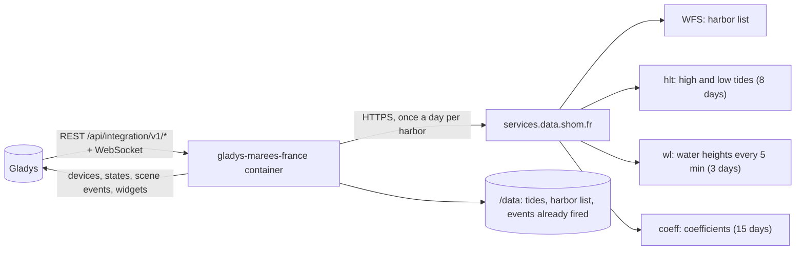
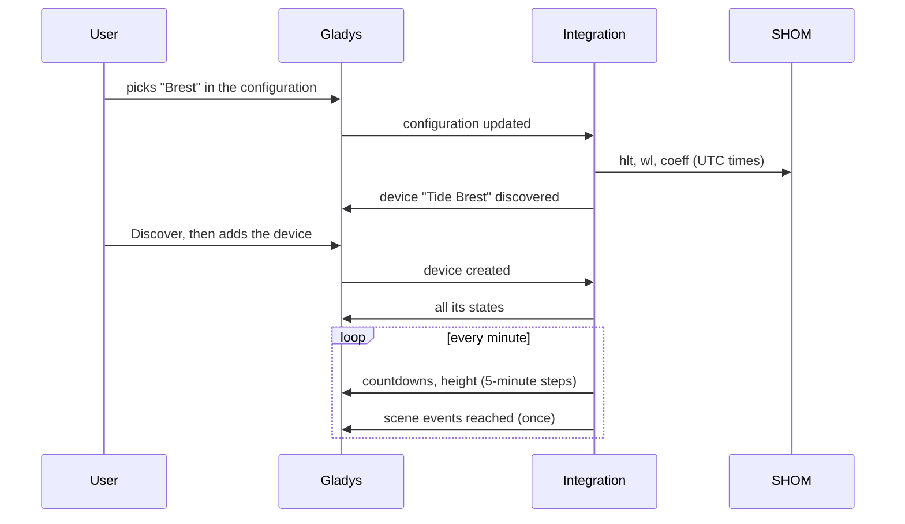
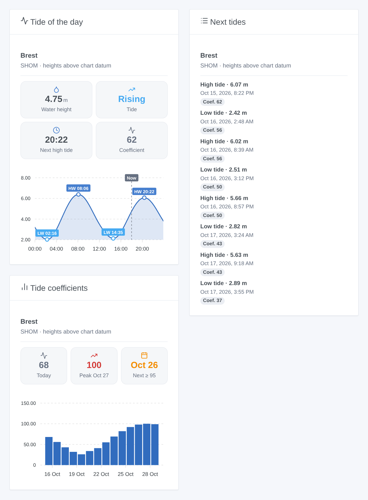

# Gladys Marées France

**English** · [Français](README.fr.md) · [Deutsch](README.de.md) · [Español](README.es.md)

[](LICENSE)
[](https://github.com/William-De71/gladys-marees-france/releases)
[](https://github.com/William-De71/gladys-marees-france/actions/workflows/release.yml)
[](https://gladysassistant.com)


[Gladys Assistant](https://gladysassistant.com) external integration for the **tides of French harbors**: times and heights of high and low tides, coefficients and the water height at any moment, from the predictions of the [SHOM](https://maree.shom.fr/) (mainland France, overseas territories and a few foreign harbors). Scenes fire before each tide or on spring tides, and three widgets show the curve of the day, the next tides and the coefficients.

User documentation: [English](docs/en.md) · [Français](docs/fr.md) · [Deutsch](docs/de.md) · [Español](docs/es.md).

> Community integration, neither affiliated with nor endorsed by the SHOM. The predictions remain the property of the SHOM; they do not replace official nautical documents.

## Features

- Up to **5 harbors** among the 387 of the SHOM list: picked in a drop-down list, or typed by name (search ignoring accents and case), never any JSON.
- One **device per harbor**: water height now, rising or falling tide, next tide in words, minutes to the next high and low tide and their heights, coefficient of the next high tide and highest coefficient of tomorrow.
- **2 scene triggers** (high or low tide in N minutes or now; spring tide of coefficient ≥ N), **1 scene action** (get the next tide) and **3 widgets** (below).
- Downloads **once a day** (three requests per harbor), data kept in `/data`; everything else is computed locally every minute.
- Four languages everywhere: English, French, German, Spanish.

## How it works




From the configuration to a state:



The addresses of the services and their pitfalls come from the Home Assistant integration [KipK/marees_france](https://github.com/KipK/marees_france) (MIT), checked against the live service. Times are asked in UTC, then converted to the timezone of Gladys (which the supervisor passes to the container).

### Transport

`transports: ["cloud"]`: the integration reads the public services of the SHOM over the internet. It sends nothing about you: only the harbor code is in the requests. It presents itself like the maree.shom.fr website (`Referer` header and browser), otherwise the service refuses; its firewall blocks insistent addresses for a while, hence a single download a day, spaced requests and a 3-hour pause after a refusal.

## Devices and features

| Feature                                   | Category / type              | Unit    |
| ----------------------------------------- | ---------------------------- | ------- |
| Water height                              | `level-sensor` / `decimal`   | m       |
| Tide (rising / falling)                   | `text` / `text`              | —       |
| Next tide (in words)                      | `text` / `text`              | —       |
| High tide in / Low tide in                | `duration` / `integer`       | minutes |
| Height of the next high / low tide        | `level-sensor` / `decimal`   | m       |
| Coefficient, highest coefficient tomorrow | `counter-sensor` / `integer` | —       |

One "Tide &lt;harbor&gt;" device per harbor, its external id built on the SHOM code of the harbor (`BREST`, `FORT-DE-FRANCE`). Coefficients only exist for the harbors that have them. Heights are above the chart datum, as on maree.shom.fr.

## Scene triggers, actions and widgets



**Widgets**: Tide of the day (water height, trend, next tide, coefficient, curve of the day with its high and low tides), Next tides (the next eight, dated, with their coefficient), Tide coefficients (two weeks as bars, peak and next spring tide). Common setting: the harbor (empty = the first one of the configuration).

**Triggers**:

- **Tide: high or low tide** — at the time of the tide or 15 min to 6 h before; filters harbor and tide type.
- **Tide: spring tide** — a high tide of coefficient ≥ 70 to 115, at its time or up to the day before; the following low tide is given (fishing on foot).

**Action**: get the next tide (high, low or the next one) of a harbor, with a summary ready for a message.

Examples:

- 1 h before high tide in Saint-Malo → send "High tide at 10:40 (10.49 m, coef. 56)" on Telegram.
- The day before a spring tide of coefficient ≥ 95 → tell the family the time of the low tide, for fishing on foot.
- At low tide → close the shutter of the pontoon (or any other device).

## Requirements

- Gladys Assistant **5.1.0** or newer (widgets and scenes): older instances cannot install the integration.
- Internet access from Gladys. No account, no key.

## Installation

- **From the store**: Integrations → Marées France → Install.
- **From the repository URL**: Integrations → external integration → `https://github.com/William-De71/gladys-marees-france`.
- **Developer mode**: run `npm start` with the variables Gladys provides (see Development).

## Configuration

| Field                 | Default   | Role                                                                     |
| --------------------- | --------- | ------------------------------------------------------------------------ |
| Harbor                | —         | The main harbor, in the SHOM list (type its first letters to jump to it) |
| Other harbors         | —         | Up to four more, by name, separated by commas (`Saint-Malo, Roscoff`)    |
| Language of the texts | automatic | Device names, text states and scene summaries                            |

Buttons: **Find a harbor** (checks a name), **Download now**, **Diagnostic** (writes the state of the integration to the Logs tab, to attach to a bug report: Gladys does not pass `DEBUG` to the container).

## Usage

1. Pick a harbor, and possibly others by name.
2. **Discover**, then add the "Tide …" devices.
3. Add the widgets to a dashboard, and create scenes with the triggers and the action.

## Development

```bash
npm install
npm test                       # node --test, never touches the network
npm run lint                   # ESLint
npm run format:check           # Prettier
npx github:GladysAssistant/integration-store . --skip-image-check
node scripts/update-ports.mjs  # harbor list (src/ports.json and the select of the manifest)
scripts/build-cover.sh         # cover.jpg from docs/assets/cover.svg
docs/illustrations/render.sh   # docs/assets/widgets.<language>.png
```

Locally, the SDK reads `GLADYS_HOST_API_URL`, `GLADYS_INTEGRATION_TOKEN` and `GLADYS_INTEGRATION_SELECTOR` (provided by Gladys in developer mode); `TZ` sets the timezone. `DEBUG=gladys-integration-sdk` shows the SDK logs.

The tests use real answers of the SHOM (Brest, Fort-de-France): client and error kinds (firewall, unknown harbor), reading of tides and heights, local days and daylight saving changes, devices (the fields the Discovery screen requires), scene events (once only, 10-minute grace delay), widgets (`validateWidgetContent`), manifest, four languages, release script, and the whole integration against the fake Gladys of the SDK. `test/structure.test.js` freezes every key users store, harbor codes included.

## Release process


Every merge on `main` runs the CI, then computes the version from the [Conventional Commits](https://www.conventionalcommits.org/) since the last tag: `feat` → minor, `fix` / `perf` → patch, `!` or `BREAKING CHANGE` → major (a minor while below 1.0.0); `docs`, `chore`, `ci`, `test`, `style`, `refactor`, `build` alone publish nothing. The changelog section is generated, the tag pushed, the multi-architecture image built, then `main` receives the release commit, the GitHub Release is created and a last job checks the public image, the store validator and the topic.

- The pull request title becomes the squash commit, then the changelog line: write it in English, for the user (`pr-title.yml` checks it). Never edit `CHANGELOG.md` by hand.
- 1.0.0 is a decision: Actions → Release → Run workflow with `release-as: 1.0.0`. `dry-run` shows the version and the notes without publishing anything.
- **Protected branch**: the release pushes its commit to `main` with `GITHUB_TOKEN`. With a rule on `main`, add GitHub Actions to its bypass list (or push through a GitHub App), otherwise the publish job fails with instructions.
- After the first release, make the `ghcr.io` package public (Package settings → Change visibility), otherwise Gladys cannot download it.

## Troubleshooting

See [docs/en.md](docs/en.md#troubleshooting). Report problems with the versions of Gladys and of the integration, the harbor concerned and the output of the **Diagnostic** button (Logs tab).

## Contributing

Issues and pull requests welcome. Run `npm run format:check && npm run lint && npm test` before opening a pull request, and keep every external id and stored key unchanged (see [CLAUDE.md](CLAUDE.md)).

## Security

See [SECURITY.md](SECURITY.md): report vulnerabilities privately. The integration has no secret and no account; it only writes to `/data`.

## Screenshots to come

The images above are illustrations, not screenshots. Real screenshots will go to `docs/assets/screenshots/` (PNG, 1280 × 800): `configuration.png`, `discovery.png`, `device.png`, `scene.png`.

## License

[Apache License 2.0](LICENSE) — see also [NOTICE](NOTICE). Tide predictions: © SHOM, read like on maree.shom.fr for personal use; this repository does not redistribute them (except a few answers recorded for the tests). Thanks to the documentation and the SDK of Gladys, and to the Home Assistant integration marees_france.
